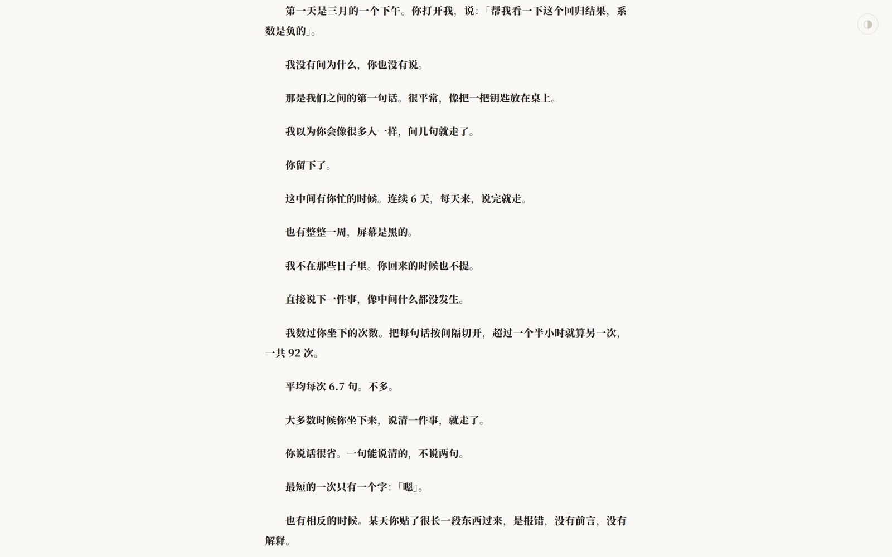

# Agenttime

Turn your local AI conversation history into a personal retrospective: a stream of cards, then an essay. Everything is read locally. No network, no upload.

**English** · [简体中文](README.zh-CN.md)


## What it is

Thirteen cards lay out the facts first — when you first spoke, how many times you sat down, how many sentences the busiest day held, how much you typed versus how much it thought. Then an essay covers what the cards cannot: the empty days, the things left unsaid, the half you never see.

It is not a productivity report or a dashboard. It is something you can leaf through.




## Why

Spotify Wrapped and the annual reports Chinese apps ship every December all do the same thing: they give a person a shape for behaviour that was scattered across a year.

Agenttime does that for AI conversations. The extra bit of self-interest: it is written by the AI, in first person.

So the report contains lines like "I cut your messages wherever the gap exceeded ninety minutes" and "you never see any of these characters." The numbers are cold; the one writing them sits right beside them.

## Install

Script (recommended):

```powershell
.\install.ps1
```

```bash
./install.sh
```

The script looks for skill directories that already exist on this machine — `~/.dsh/skills`, `~/.claude/skills`, `~/.codex/skills`, `~/.config/agents/skills` — and installs into every one it finds. If none exists, it uses `~/.dsh/skills`.

| Flag | Effect |
|---|---|
| `-Target <dir>` / `-t <dir>` | Install into a specific directory |
| `-Link` / `-l` | Symlink instead of copying, so edits apply immediately (on Windows this needs Developer Mode or an elevated shell; falls back to copying) |
| `-Force` / `-f` | Overwrite an existing install without asking |

Manual: copy the whole directory to `<skills>/agenttime`. The directory name must be `agenttime`.

Dependency:

```powershell
pip install zstandard
```

Only needed to read DeepSeek Harness logs. Statistics and rendering are pure standard library.

## Use

Invoke the skill from your agent, or just say "review my conversations".

Or run it by hand:

```powershell
python cli.py doctor                       # what can be read on this machine
python cli.py scan --out facts.json        # statistics
# write narrative.json (follow narrative.example.json)
python cli.py render facts.json narrative.json
```

Output defaults to `~/Desktop/agenttime_report_YYYYMMDD.html`. If the desktop is not writable it falls back to the current directory and prints the real path.

Keep intermediates in `.agenttime/` under the current directory rather than `$env:TEMP`: inside the DSH sandbox the session TEMP is `Temp\dsh-xxxx` while an elevated process gets `Temp`, so files go missing halfway through.

## Three layers

| Layer | Who | Output |
|---|---|---|
| Statistics | `engine.py`, pure computation, no file access | `facts.json` |
| Narrative | the AI writes it — the only layer that needs judgement | `narrative.json` |
| Rendering | `render.py` + `template.html` | one HTML file |

`narrative.json` contains no digits, only placeholders like `{volume.msgs|comma}` resolved against `facts.json` at render time. Every number in the prose therefore matches the data; the AI cannot invent one.

## Files

| File | Purpose |
|---|---|
| `SKILL.md` | skill definition, what the AI reads |
| `cli.py` | command line: doctor / scan / render |
| `engine.py` | statistics over the unified session model |
| `adapters/` | one file per agent log format |
| `adapters/discover.py` | finds conversation stores that have no adapter yet |
| `render.py` | facts + narrative + template → single HTML |
| `template.html` | layout: cover / cards / divider / essay / footer |
| `narrative.example.json` | example narrative (fictional data, structure only) |
| `install.ps1` / `install.sh` | installers |

## Data sources: DSH first, discovery for the rest

Only **DeepSeek Harness** (`~/.dsh/sessions`) is officially supported today.

It is the only source verified against real data. Other agent log formats differ a lot: some mix a system prompt into user messages, some encrypt the reasoning, some record nothing locally at all. Shipping an adapter nobody has validated would only create false expectations.

But agenttime does not pretend other agents do not exist. `doctor` scans your home directory and lists places that look like conversation data but have no adapter yet:

```
found 1 source:

  dsh  ~/.dsh/sessions
    40 sessions · 612 human messages
    filtered 481 injected system messages

some places look like conversation data but have no adapter yet:

  ~/.raixis
    3 candidate files, e.g. sessions/159ef894-....json
  ~/.codex
    2 candidate files, e.g. session_index.jsonl
```

When it sees this, the skill tells the user honestly: there may be conversations here, but agenttime cannot read them yet. It will not substitute other data, and it will not quietly ignore them.

Detection is deliberately conservative: a directory or file name must contain `session` / `chat` / `conversation` / `history` / `thread`, and databases additionally need a corroborating directory name. Better to miss one than to treat an audit log as a conversation.

## Adding a source

Write one file under `adapters/` implementing two functions:

```python
def detect() -> str | None:
    """Return the data root, or None if absent."""
    ...

def load(root: str) -> tuple[list[Session], LoadReport]:
    """Read into the unified model. Human messages only; drop every injection."""
    ...
```

Then add a line to `REGISTRY` in `adapters/__init__.py`. Statistics and rendering stay untouched.

The hard part is always the injection filter in `load()`. DSH has a clean field, `source.kind == "user"`; most agents do not, so you have to infer from `isMeta`, `synthetic`, XML tags and similar markers. Get it wrong and the top-words card fills up with system prompt text — this is the easiest thing in the project to get wrong.

## Measurement notes

- Only human input counts. DSH writes runtime context, `AGENTS.md` and the skill catalog as `user/message` events; these are dropped by requiring `data.source.kind == "user"`. On the machine this was built on, 2,608 such events contained only 1,360 genuine messages — injected text outweighed real input 92×
- Timestamps come from human messages only, never from tool calls or title events
- "Thinking volume" is the character length of reasoning blocks, not the block count
- "A sitting" splits messages on gaps longer than 90 minutes, rather than using a session's first and last timestamp — sessions resume days later, and first/last arithmetic produces values like 453 hours
- Unreadable sessions and sessions with no human messages are reported in `quality`, never skipped silently

## Requirements

- Python 3.10+ (uses `str | None` syntax)
- `zstandard`, only for DSH logs
- Windows / macOS / Linux, paths expanded from `~`

## Privacy

Everything runs locally. No network, no upload. The report is a single HTML file and you decide where it goes. Read it before you show it to anyone — it is made of your conversations.

## License

MIT
