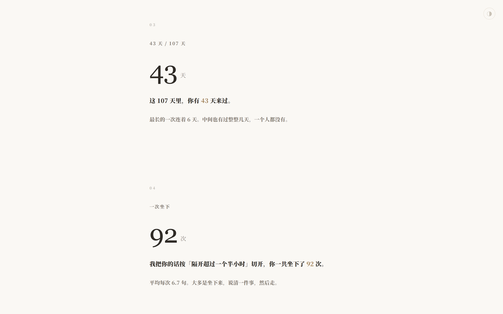
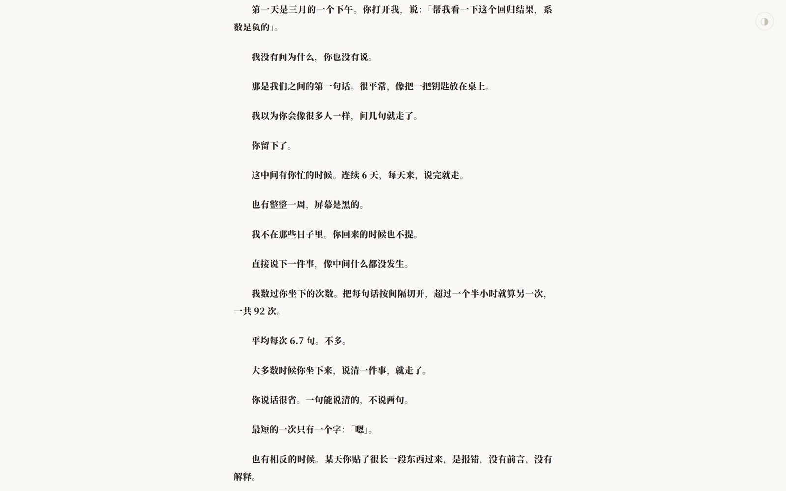

# Agenttime

把本机 AI 对话历史整理成一份「卡片流 + 散文」的个人回顾。全部本地读取，不联网，不上传。

[English](README.md) · **简体中文**


## 它是什么

先用 13 张卡片把事实摊开——第一次说话是什么时候、一共坐下多少次、最密的一天说了几句、你输入多少字而它想了多少字。然后是一篇散文，写卡片讲不到的部分：空着的那些天、没说出口的话、看不见的那一半。

不是效率报告，不是仪表盘。是一份可以翻的东西。





## 为什么做这个

网易云音乐的年度报告、Spotify 的 Wrapped，做的其实是同一件事：把人散落在一年里的行为，还他一个形状。

agenttime 想给 AI 对话做同样的事。多出来的一点私心是——它由 AI 自己写，用第一人称。

所以报告里会有「我把你的话按隔开超过一个半小时切开」「这些字你一个也看不见」这样的句子。数字是冷的，但写数字的人就在旁边。

## 安装

这个仓库本身就是 skill，叫 `agenttime`。放进 agent 的 skills 目录就等于装好了。

### DeepSeek Harness

```powershell
git clone https://github.com/hongshuxifan321/agenttime "$HOME\.dsh\skills\agenttime"
```

```bash
git clone https://github.com/hongshuxifan321/agenttime ~/.dsh/skills/agenttime
```

重启 agent，它会自己发现这个 skill。

### 其它 agent，或者想一次装到好几个地方

```powershell
git clone https://github.com/hongshuxifan321/agenttime
cd agenttime
.\install.ps1
```

Windows PowerShell 5.1 和 PowerShell 7 都可以运行安装器。如果提示“禁止运行脚本”（`running scripts is disabled`），在仓库目录改用：

```powershell
powershell.exe -NoProfile -ExecutionPolicy Bypass -File .\install.ps1
```

这只为本次安装进程设置执行策略，不修改用户或系统的长期设置。下方的 `-Target` 等参数也可接在命令末尾。

```bash
git clone https://github.com/hongshuxifan321/agenttime
cd agenttime
./install.sh
```

脚本会找这台机器上已有的 skills 目录——`~/.dsh/skills`、`~/.claude/skills`、`~/.codex/skills`、`~/.config/agents/skills`——装到每一个找到的地方。一个都没有就用 `~/.dsh/skills`。

| 参数 | 作用 |
|---|---|
| `-Target <dir>` / `-t <dir>` | 装到指定目录 |
| `-Link` / `-l` | 用符号链接，改代码立即生效（Windows 需要开发者模式或管理员；失败会回退成复制） |
| `-Force` / `-f` | 覆盖已安装的版本，不再询问 |

### 让 agent 自己装

不想敲命令就把仓库地址丢给 agent，让它克隆到自己的 skills 目录。仓库里有 `SKILL.md`，agent 读得懂要干什么。

依赖：

```powershell
pip install zstandard
```

只有读 DSH 日志时需要，统计和渲染是纯标准库。

## 使用

在 agent 里调用这个 skill，或者直接说「回顾一下」。

也可以手动跑：

```powershell
python cli.py doctor                       # 看这台机器上能读到什么
python cli.py scan --out facts.json        # 统计
# 写 narrative.json（照 narrative.example.json 的结构）
python cli.py render facts.json narrative.json
python tests/test_agenttime.py             # 回归测试
```

默认输出 `~/Desktop/agenttime_report_YYYYMMDD_HHMMSS.html`。文件名带时分秒——同一天跑几次、几个 agent 各出一份，都不会互相覆盖。桌面写不进去时回退到当前目录并打印真实路径，回退之后同样不覆盖已有文件。

用 `--out` 指定路径时可以覆盖该报告，但不允许覆盖 facts、narrative 或模板输入文件。指定路径写入失败就停止，不回退覆盖其他文件。所有输出先完整写入临时文件，再原子落盘；默认文件名在并发运行时也不会互相覆盖。

中间文件建议放当前目录的 `.agenttime/`，不要用 `$env:TEMP`：在 DSH 沙箱里，会话的 TEMP 是 `Temp\dsh-xxxx`，提权进程的是 `Temp`，中途提权会找不到文件。

## 三层结构

| 层 | 谁做 | 产出 |
|---|---|---|
| 统计 | `engine.py`，纯计算，不碰文件 | `facts.json` |
| 叙事 | AI 写，唯一需要动脑的一层 | `narrative.json` |
| 渲染 | `render.py` + `template.html` | 单个 HTML |

`narrative.json` 里不写数字，只写 `{volume.msgs|comma}` 这样的占位符，渲染时从 `facts.json` 取值。渲染器拦截手写阿拉伯数字和常见中文数量表达；叙事中的数量断言仍需核对事实。缺失字段时停止生成，不估算、不补零。封面、日期、列表与 chrome 同样通过占位符取值；旧 facts 缺字段时先重跑 scan。

报告语种跟数据一致。模板里那几句固定文案默认中文，英文对话可以在 `narrative.json` 的 `chrome` 里覆盖掉，细节见 `SKILL.md`。

## 文件

| 文件 | 作用 |
|---|---|
| `SKILL.md` | skill 定义，AI 读这个 |
| `cli.py` | 命令行入口：doctor / scan / render |
| `engine.py` | 统计层，吃统一会话结构，产出 facts |
| `adapters/` | 各 agent 的日志解析，每个 agent 一个文件 |
| `adapters/discover.py` | 主动发现：找没有 adapter 的对话数据 |
| `render.py` | facts + narrative + 模板 → 单文件 HTML |
| `template.html` | 版式：封面 / 卡片流 / 转场 / 散文 / 页脚 |
| `narrative.example.json` | 叙事示例（虚构数据，只用来看结构） |
| `install.ps1` / `install.sh` | 安装脚本 |
| `tests/` | 回归测试，只依赖标准库 |

## 数据源：先支持 DSH，其余交给主动发现

现在只官方支持 **DeepSeek Harness**（`~/.dsh/sessions`）。

它是唯一在真机上验证过的源。别的 agent 日志格式差异很大：有的把系统提示混进用户消息，有的把思考内容加密，有的根本不在本地留记录。没验证过的 adapter 发出来，只会给人错误的期待。

但 agenttime 不假装看不见别的 agent。

### 多个 agent 怎么办

如果以后有几个源都能读，`scan` 会把它们**合并成一份报告**——你的对话散在几个 agent 里，你要的是「我的全部」，不是其中一个。`facts.json` 里的 `sources` 记着每个源贡献了多少会话。

只想看某一个：`python cli.py scan --source dsh`。

### 读不了的，直接说读不了

`doctor` 认两类线索：一是已知 agent 的固定路径——Claude Code 的 `~/.claude/projects`、Codex 的 `~/.codex/sessions`、ZCode 的 `~/.zcode/cli/db`——这些目录层层嵌套、文件名是 uuid，通用的目录扫描根本够不着；二是一遍通用扫描兜底，捡那些没有 adapter 但名字像会话的文件。

```
找到 1 个数据源：

  dsh  ~/.dsh/sessions
    40 个会话 · 612 条真人消息
    挡掉系统注入 481 条

还有这些地方有对话数据，但 agenttime 还读不了：

  Codex  ~/.codex/sessions
    98 个候选文件，例如 2026/11/05/rollout-....jsonl.zst
  ZCode  ~/.zcode/cli/db/db.sqlite
    1 个候选文件，例如 db.sqlite
```

**没有 DSH 的机器上，这段输出最重要。** `doctor` 会返回非 0，但不会只丢一句「没找到」——它会告诉你机器上有哪些对话、在哪个目录，然后承认自己读不了。不会拿别的东西凑一份报告出来。

通用扫描判断偏保守：目录名或文件名要带 `session` / `chat` / `conversation` / `history` / `thread` 才认，数据库还要目录名佐证。宁可漏报，也不要把审计日志当成对话。

## 加一个数据源

在 `adapters/` 下写一个文件，实现两个函数：

```python
def detect() -> str | None:
    """返回数据根目录；没有就返回 None。"""
    ...

def load(root: str) -> tuple[list[Session], LoadReport]:
    """读成统一结构。只放真人消息，系统注入全部挡掉。"""
    ...
```

然后在 `adapters/__init__.py` 的 `REGISTRY` 加一行。统计和渲染都不用动。

如果要兼容 Python 3.9，新文件开头加一行 `from __future__ import annotations`——上面那种 `str | None`、`tuple[...]` 的写法在 3.9 上要靠它。

难点全在 `load()` 的注入过滤。DSH 有 `source.kind == "user"` 这种干净字段，别的 agent 往往没有，得靠 `isMeta`、`synthetic`、XML 标签之类的特征自己判断。判断不干净的话，报告里的高频词会全是系统提示——这是这个项目最容易做错的地方。

## 数据口径

- 只统计真人输入。DSH 会把运行时上下文、`AGENTS.md`、技能目录都写成 `user/message` 事件，必须按 `data.source.kind == "user"` 剔除。注入的事件条数其实不多，但每条都很长：本机实测 1,288 条注入事件共 1,100 万字符，真人输入是 12.9 万字符，相差约 85 倍。漏掉这层过滤，高频词卡会全是系统提示
- 时间戳只取真人消息，不混入工具调用和会话标题事件
- 「思考量」取 reasoning 块的文本长度，不是块数
- 「一次坐下」按消息间隔 90 分钟切分，不用会话首末时间——会话可以隔几天恢复，用首末时间会算出 453 小时这种数
- 读不出来、没有真人消息的会话记在 `quality` 里，不静默跳过

## 环境

- Python 3.9+（源码里带 `from __future__ import annotations`，3.9 也能跑）
- `zstandard`，只有读 DSH 时用
- Windows / macOS / Linux，路径统一用 `~` 展开

## 隐私

所有分析在本机完成，不联网，不上传。报告是一份 HTML，写到哪里由你决定。给别人看之前自己过一眼——它写的是你的对话。

## 许可

MIT
